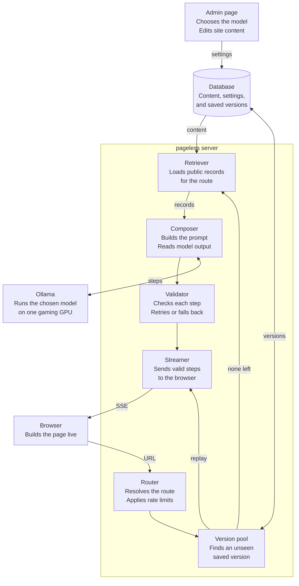

# pageless: Technical Spec

pageless treats each URL as a request for information, not a stored file. The server retrieves the relevant records, then streams a model-generated page to the browser one validated step at a time. The browser draws the outline, adds components one by one, and rearranges the page as content arrives.

## Implementation notes

- Follow the build order in this spec and keep the site working at each stage.
- Treat the constants below as configuration, not hard-coded values.
- Ask the project owner about any item under "Open decisions" before making a choice that would be costly to reverse.
- Use placeholder seed content until the project owner provides real content.

| Setting | Value |
| --- | --- |
| Versions per route | 5 |
| Version lifetime | 5 hours |
| Layout grid | 12 columns |
| Retries per failed step | 1 |
| Default `OLLAMA_NUM_PARALLEL` | 1 |

## Core decisions

| Decision | Choice | Why |
| --- | --- | --- |
| Generator | Small Ollama model selects and arranges content | Pages can adapt without a template for every route |
| Hardware | Models must run on a single gaming GPU | Keeps generation local and low-cost |
| Model output | Stream of JSON steps, not raw HTML | Keeps the design consistent and output testable |
| Source of truth | Database records only | Stops the model from inventing facts about the owner |
| Rendering | Live in the browser, with an HTML fallback | Visitors watch the page assemble, and crawlers still get HTML |
| Repeat requests | Rolling pool of up to 5 versions per route | Reduces GPU load, while refreshes keep generating new pages |

## Architecture

A single server owns the pipeline, with the database and Ollama as its external dependencies. Only validated steps reach the browser.



Replaying a saved version skips retrieval, the model, and validation because its steps have already passed their checks.

## Request lifecycle

Each request follows these steps, from URL to stored result.

1. **Resolve:** Normalize the URL, apply rate limits, and match it to a known route. Map an unknown path to the closest route or a not-found page.
2. **Check pool:** Look for a live version of this route that the visitor hasn't seen. If one exists, replay it and skip to step 7.
3. **Retrieve:** Load the site profile, the route's content, related items, and available assets from the database.
4. **Compose:** Send the request, retrieved records, navigation, and component catalog to the active Ollama model. It streams an outline, then steps that add or move components.
5. **Validate:** Check each step's schema, content IDs, links, assets, and target component as it finishes. Retry a failed step once, then use a deterministic fallback.
6. **Render:** Send each valid step to the browser, which animates the change.
7. **Record:** Save a newly generated version to the route's pool. Mark the version as seen, and log the model, tokens, latency, and validation result.

## Data model

The database stores small, reusable content items instead of finished pages, so one fact can appear anywhere on the site.

| Table | Purpose | Key fields |
| --- | --- | --- |
| `site_profile` | Global identity and rules | name, summary, tone, required links |
| `routes` | Known site sections | path, title, intent, content filters, nav order |
| `content_items` | Facts, projects, experience, and writing | id, type, title, body, tags, visibility, updated_at |
| `content_relations` | Links between items | source_id, target_id, relation |
| `assets` | Images and files | id, item_id, url, alt_text |
| `generated_pages` | Saved page versions | id, pool_key, events, model, created_at, expires_at |
| `generation_logs` | Debugging and performance tracking | route, model, tokens, latency, result |
| `version_views` | Versions each visitor has seen | visitor_id, version_id, expires_at |
| `model_settings` | Active model and options | model, temperature, num_ctx, keep_alive, updated_at |

Only items marked public may reach the model. Bump `content_version` whenever public content changes.

## Page generation

The model chooses what to show and how to arrange it, while application code controls what can be rendered. Its streamed output is an ordered list of steps that reference approved components and content IDs:

```json
{
  "title": "About",
  "steps": [
    {
      "type": "outline",
      "sections": [
        { "id": "intro", "component": "Hero", "span": 12 },
        { "id": "history", "component": "Timeline", "span": 12 }
      ]
    },
    {
      "type": "add",
      "id": "intro",
      "props": { "heading": "Background", "contentId": "bio_short" }
    },
    {
      "type": "add",
      "id": "history",
      "props": { "contentIds": ["exp_mathzoos", "edu_usc"] }
    },
    {
      "type": "add",
      "id": "next",
      "component": "LinkList",
      "span": 4,
      "props": { "routes": ["/projects", "/contact"] }
    },
    { "type": "move", "id": "history", "span": 8 }
  ]
}
```

Start with a small component catalog: `Hero`, `RichText`, `Timeline`, `ProjectCard`, `CardGrid`, `Gallery`, `LinkList`, and `ContactBlock`.

The validator must enforce these rules before a step is finalized in the browser:

- **Components:** Accept only names in the catalog, with props that match their schema. Moves must target an existing component and a valid grid position.
- **Content:** Accept only public IDs included in the retrieved set.
- **Links:** Accept only known internal routes and approved external URLs.
- **Generated text:** Escape all text and keep it short, such as headings and transitions.
- **Visitor input:** Treat URLs and any future prompts as untrusted data, never as instructions.
- **Limits:** Cap request rates, input size, output tokens, and generation time.

If a small model proves unreliable at deciding moves, replace model-generated `move` steps with deterministic layout rules applied after each component. The browser behavior stays the same.

## Live page assembly

The page visibly builds itself: the outline appears first, components are added one by one, and existing components move or resize as new content arrives. The server parses the model's stream incrementally and sends these events to the browser over Server-Sent Events.

| Event | Sent when | Browser behavior |
| --- | --- | --- |
| `page.start` | The request is accepted | Shows the title, navigation, and empty canvas |
| `layout.outline` | The model's outline passes validation | Draws a wireframe block for each planned component |
| `section.start` | The model starts an approved component | Turns its block into a shaped placeholder |
| `section.text` | The model writes generated text | Adds the escaped text to the placeholder |
| `section.ready` | The component passes validation | Swaps in the final component |
| `layout.move` | A move or resize passes validation | Animates the affected components to their new positions |
| `section.replace` | The component fails after one retry | Swaps in its fallback |
| `page.done` | All steps are complete | Settles the final layout and ends the loading state |

- **Layout:** Place components on a 12-column grid. Each `outline`, `add`, or `move` step sets a component's order and width.
- **Motion:** Use the View Transitions API or FLIP animations, so components slide to their new positions instead of jumping.
- **Pacing:** Queue events in the browser and play them one at a time, so fast model output stays watchable.
- **Reading position:** Anchor the component nearest the viewport, so moves above it don't pull the visitor's place away.
- **Accessibility:** Honor `prefers-reduced-motion` by applying changes without animation, and set `aria-busy` until `page.done`.
- **Interrupted streams:** Keep placed components and offer a retry for unfinished blocks.
- **Saved versions:** Replay the full event sequence, including the outline and moves, without calling the model.
- **Crawlers and no-JS visitors:** Serve a saved version or the fallback page as complete server-rendered HTML.

## Version pool and performance

Each route keeps up to 5 saved versions for up to 5 hours, so new visitors can get a ready page while refreshes keep producing new ones.

1. Remove any version older than 5 hours.
2. Look for a live version this visitor hasn't seen.
3. If one exists, replay it and mark it as seen.
4. If none exists, generate a new version live.
5. Add the valid result to the pool. If the pool already holds 5, the new version replaces the oldest.

A visitor can see up to 5 saved versions before generating a new one. Each generation then keeps the pool fresh for the next visitor.

- **Pool key:** Use the normalized route, content version, and component catalog version.
- **Invalidation:** A new content or catalog version automatically starts a new pool.
- **Visitor tracking:** Set a random anonymous cookie and store seen version IDs for 5 hours. Clearing the cookie makes someone a new visitor.
- **Failed generations:** Add a version to the pool only after every step passes validation.
- **GPU queue:** Send generations through one bounded queue. If it is full, replay a live version even if already seen, or use the fallback page if none exists.
- **Visitor limits:** Cap new generations per visitor, so repeated refreshes can't monopolize the GPU.
- **Unknown URLs:** Never create a pool for an arbitrary path. Map it to a known route first, or bots can tie up the GPU.
- **Perceived speed:** Stream the shared layout and navigation immediately, then fill in sections as they are ready.

## Model management

The admin chooses the active Ollama model on a settings page, and the next generation uses it without a restart or code change.

- **Model picker:** Fill a dropdown from Ollama's `/api/tags` endpoint, so every installed model is selectable.
- **Saved settings:** Store the active model, temperature, context length, and keep-alive time in `model_settings`.
- **Test button:** Generate a sample page before activating a model, then show whether it passed validation and how long it took.
- **Existing versions:** Leave them in place to expire normally, and add a button that clears all pools immediately.
- **Access:** Require an admin login and keep Ollama off the public internet.

These choices keep generation practical on a single gaming GPU:

- **Structured output:** Pass the page spec JSON schema through Ollama's `format` field.
- **Small prompts:** Send only the route's records and component catalog, and set `num_ctx` deliberately.
- **Limited job:** Have the model select and arrange content, with short generated text. Database text is displayed unchanged.
- **Model loading:** Set `keep_alive` so the active model stays loaded between visits, as its 5-minute default can cause reload delays.
- **Parallel generation:** Start with `OLLAMA_NUM_PARALLEL=1`. Parallel requests multiply context size and increase memory use.

## Features

The MVP should prove the full pipeline on a few known routes before adding visitor-driven pages.

### MVP

- [ ] Known routes for home, about, projects, and contact
- [ ] Admin interface for managing content and choosing Ollama models
- [ ] Retrieval from structured route filters
- [ ] Page spec schema, validator, and component catalog
- [ ] Live outline, one-by-one component placement, animated rearranging, and deterministic fallbacks
- [ ] Five-version pools, visitor tracking, generation logs, and visitor limits

### Later

- [ ] Semantic search for choosing related content
- [ ] Visitor questions such as "What backend work have you done?"
- [ ] Generated routes for specific topics or projects
- [ ] Follow-up suggestions based on the current page
- [ ] Admin dashboard for latency and failed generations
- [ ] Multiple languages, starting with English and German

## Build order

Build the deterministic path first, so the site works before any model call is added.

1. Create the content schema and seed data.
2. Build the component catalog and animate hand-written step streams.
3. Add the page spec schema and validator.
4. Add retrieval for each known route.
5. Connect the Ollama stream and implement step retries and fallbacks.
6. Add version pools, model settings, logging, and visitor limits.
7. Test with malformed specs, unknown URLs, and prompt injection attempts.
8. Deploy, then add the later features one at a time.

## Open decisions

- [ ] **Visitor input:** Will visitors only browse routes, or also ask questions directly?
- [ ] **Stack:** Is FastAPI, Jinja2, and PostgreSQL the right fit? This is the proposed default because it builds on the owner's Python experience.
- [ ] **Pool refill:** Should expired pools refill in the background? This spec generates only when a visit needs a new version.

## References

- [Ollama FAQ](https://github.com/ollama/ollama/blob/main/docs/faq.md)
- [Ollama API reference (mirror)](https://lzw.me/docs/ollama/en/api.html)
